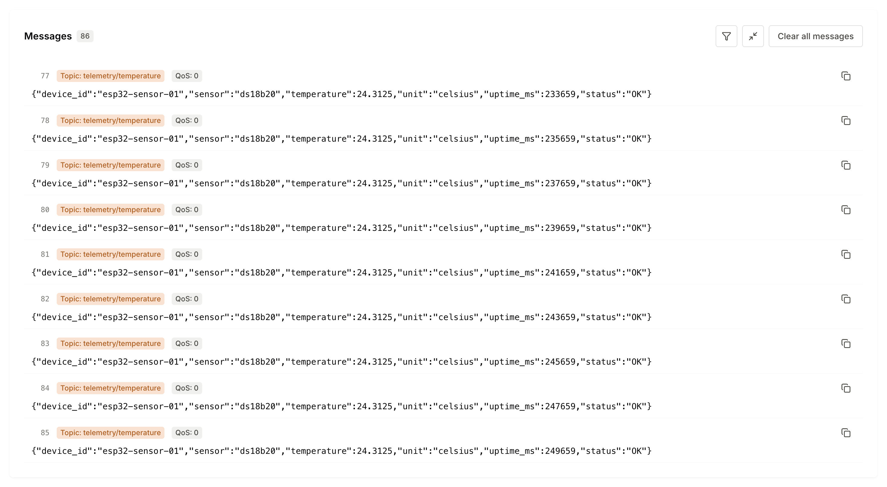
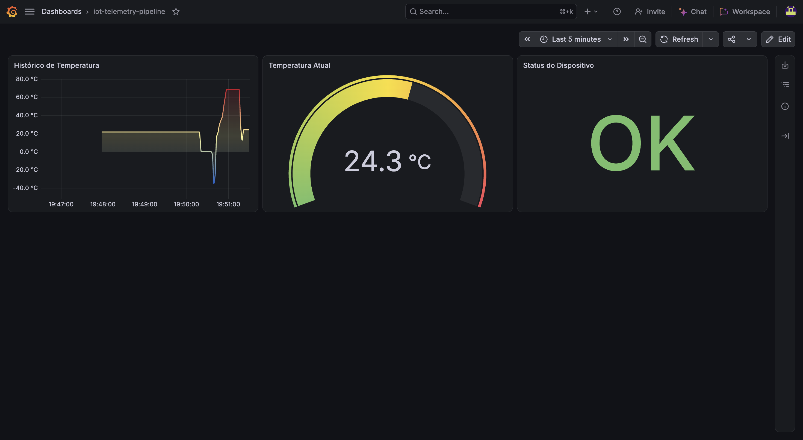

# Pipeline de Telemetria IoT: ESP32, Go Worker, InfluxDB e Grafana

> **Sistema end-to-end de ingestão e monitoramento térmico**
>
> _Arquitetura em monorepo para aquisição de dados com ESP32, transmissão via MQTT/TLS no HiveMQ Cloud, processamento assíncrono em Go e persistência temporal no InfluxDB para visualização no Grafana._

Este repositório implementa uma pipeline de telemetria IoT para coletar, processar e monitorar dados de temperatura.

## 1. Arquitetura e Fluxo do Sistema

```text
+-------------------+        1-Wire        +-------------------+
|  Sensor DS18B20   | -------------------> |       ESP32       |
+-------------------+                      +-------------------+
                                                   |
                                         MQTT / TLS (8883)
                                                   v
+-------------------+      Subscrição      +-------------------+
|     Go Worker     | <------------------- |    HiveMQ Cloud   |
+-------------------+                      +-------------------+
         |
     Write API
         v
+-------------------+     Data Source      +-------------------+
|     InfluxDB      | -------------------> |      Grafana      |
+-------------------+                      +-------------------+
```

### Fluxo do Firmware (C++)

1. **Amostragem:** lê o DS18B20 pelo barramento 1-Wire (`GPIO 14`) a cada 2000 ms.
2. **Validação:** identifica leituras inválidas, incluindo o valor `-127.0 °C` associado à desconexão do sensor.
3. **Serialização:** estrutura as leituras em um payload JSON.
4. **Transmissão:** publica as mensagens via MQTT/TLS no tópico configurado do HiveMQ Cloud.

### Fluxo do Worker (Go)

1. **Ingestão:** conecta-se ao HiveMQ Cloud e subscreve o tópico `telemetry/temperature`.
2. **Desacoplamento:** encaminha as mensagens recebidas para um canal interno (`chan telemetry.Payload`).
3. **Processamento:** uma goroutine consumidora converte os payloads em pontos de séries temporais.
4. **Persistência:** grava os dados no InfluxDB por meio da API de escrita.
5. **Graceful Shutdown:** trata sinais `SIGINT` e `SIGTERM` para encerrar o processamento e liberar os recursos de forma controlada.

## 2. Estrutura do Payload JSON

O firmware representa falhas de leitura explicitamente, enviando `temperature: null` quando o sensor está desconectado. O worker utiliza o campo `status` para distinguir leituras válidas de eventos de desconexão.

| Estado do Sensor                  | Leitura do Hardware                       | Temperatura JSON       | Status JSON      | Ação no Backend Worker                                              |
|-----------------------------------|-------------------------------------------|------------------------|------------------|---------------------------------------------------------------------|
| **Sucesso (`Success`)**           | Leitura válida entre -55 °C e 125 °C      | `float` (ex.: `24.50`) | `"OK"`           | Persiste a temperatura e o uptime no InfluxDB.                      |
| **Desconectado (`Disconnected`)** | Leitura `-127.0 °C` ou falha identificada | `null`                 | `"DISCONNECTED"` | Registra o evento de desconexão conforme a implementação do worker. |

Em operação normal:

```json
{
  "device_id": "esp32-sensor-01",
  "sensor": "ds18b20",
  "temperature": 24.50,
  "unit": "celsius",
  "uptime_ms": 12000,
  "status": "OK"
}
```

Em caso de desconexão do sensor:

```json
{
  "device_id": "esp32-sensor-01",
  "sensor": "ds18b20",
  "temperature": null,
  "unit": "celsius",
  "uptime_ms": 14000,
  "status": "DISCONNECTED"
}
```

> [!NOTE]
> **Integridade dos dados:** a representação explícita de leituras inválidas evita tratar falhas do sensor como temperaturas numéricas em agregações e visualizações.

## 3. Evidências e Visualização

A validação operacional da pipeline foi realizada acompanhando a recepção das mensagens no broker e a renderização dos dados em tempo real no dashboard.

### Mensagens no HiveMQ Cloud

Captura das mensagens JSON recebidas no tópico MQTT via conexão TLS.



### Dashboard no Grafana

Visualização da série temporal de temperatura e do estado do dispositivo, com dados provenientes do InfluxDB.


